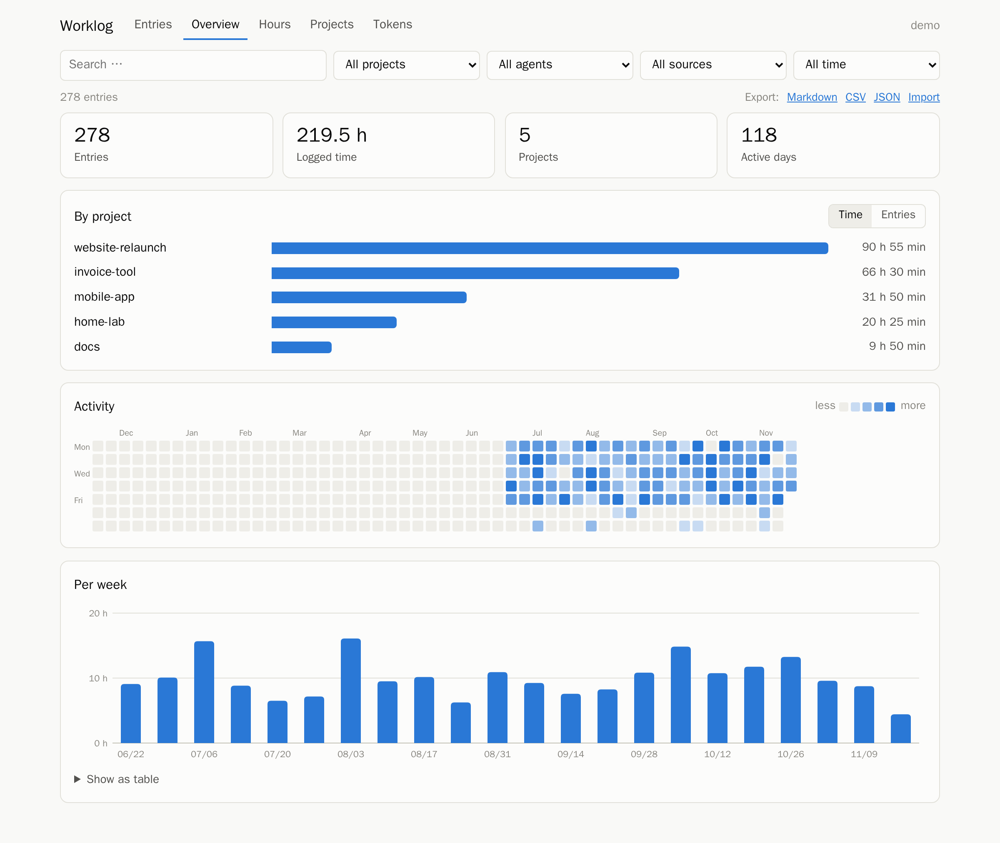

# worklog

[](https://github.com/axute/worklog-mcp/actions/workflows/docker.yml)
[](https://github.com/axute/worklog-mcp/releases)
[](https://github.com/axute/worklog-mcp/pkgs/container/worklog-mcp)
[](LICENSE)

**Your AI agents keep your work log.** worklog is an MCP server: Claude Code, Claude Desktop, claude.ai and other MCP clients record what they finished – one entry per result – and you get it back as a searchable log, reports and a timesheet.

<picture><source media="(prefers-color-scheme: dark)" srcset="docs/images/overview-dark.png"></picture>

## Features

- **For agents:** tools to log, correct and search entries, and prompts for weekly and monthly reports, a stand-up and for logging the history of an old project from its git log afterwards.
- **Web view:** entries with full text search and filters, overview with activity calendar, timesheet with rounding, project notes, duplicate detection, entries by hand, light and dark, English and German. [More](docs/web.md)
- **Your data:** export as Markdown, CSV or JSON; JSON import between instances; import of earlier Claude Code, claude.ai and JetBrains Junie sessions. [More](docs/data.md)
- **Reports:** weekly or monthly report as a file and as a notification to ntfy, Discord, Telegram, e-mail and more (Apprise).
- **Safe by default:** one token per agent (stored as a hash, the agent name comes from the token), several users strictly separated, optional sign-in through your reverse proxy (e.g. Authelia).
- **Small:** one container, SQLite, HTTP (Streamable HTTP) or stdio; images for amd64 and arm64.

## Quick start

Run the server on your machine and connect Claude Code to it. For a server that other devices or claude.ai reach over HTTPS, continue with the [setup guide](docs/setup.md).

**With Docker** (image for amd64 and arm64 from GitHub Container Registry):

```bash
mkdir -p ~/worklog-data && sudo chown 99:100 ~/worklog-data      # container runs as UID 99; skip on Docker Desktop
docker run -d --name worklog-mcp --restart unless-stopped \
  -p 127.0.0.1:8000:8000 -v ~/worklog-data:/data ghcr.io/axute/worklog-mcp:latest

docker exec worklog-mcp worklog token create laptop --owner me   # prints the token (wl_...) once
```

**Without Docker** (Python 3.12 or newer):

```bash
python3 -m venv ~/.worklog && . ~/.worklog/bin/activate
pip install git+https://github.com/axute/worklog-mcp.git           # needs git

export WORKLOG_DB=~/worklog/worklog.db WORKLOG_HOST=127.0.0.1    # default: /data/worklog.db on 0.0.0.0
worklog-server                                                    # runs in the foreground; Ctrl+C stops it

# in a second terminal, with the same WORKLOG_DB:
worklog token create laptop --owner me                            # prints the token (wl_...) once
```

**Connect Claude Code** and check:

```bash
claude mcp add --transport http --scope user worklog http://127.0.0.1:8000/mcp \
  --header "Authorization: Bearer wl_..."
claude mcp list                                                   # worklog … ✓ Connected
```

In a new Claude Code session, ask for example *"Log to worklog: project test, summary 'worklog is running'"*. The entry shows up in the web view at <http://127.0.0.1:8000/ui/> (sign in there with a token that has the `read` scope; `laptop` has it), or with `worklog export --owner me`. To make agents log on their own, add the [agent rule](integrations/agent-rule.md) to `~/.claude/CLAUDE.md`.

## Documentation

- [Setup guide](docs/setup.md): from an empty server to agents that log on their own – HTTPS, Traefik, clients (Claude Code, claude.ai, VS Code, stdio), agent rule, reminder hook, backups and updates
- [MCP tools, prompts and REST API](docs/tools.md)
- [Web view](docs/web.md): views, sign-in, rights
- [Users, tokens and data](docs/data.md): users, tokens, export and import, reports and notifications, importing earlier sessions
- [Configuration](docs/configuration.md): all environment variables
- [Changelog](CHANGELOG.md)

## Development

```bash
./scripts/test.sh          # pytest in a python:3.12-slim container, dependencies cached in a Docker volume
./scripts/test.sh -k auth  # extra pytest arguments are passed through
```

The tests start the real server on `127.0.0.1` with a temporary database and talk to it with the FastMCP client; no outside network is used.

## License

MIT, see [LICENSE](LICENSE).
