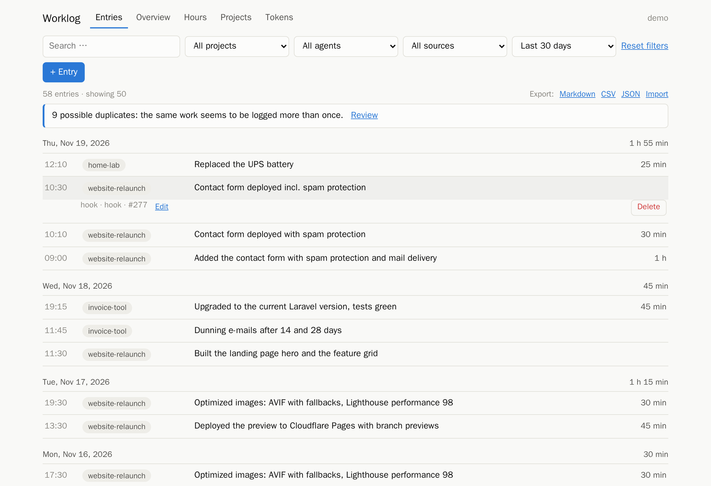
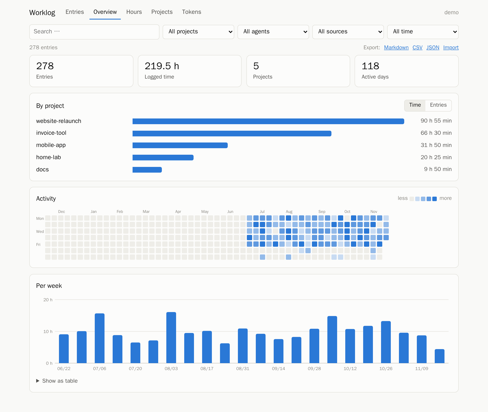
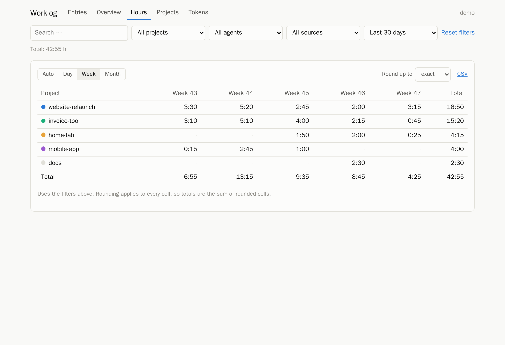
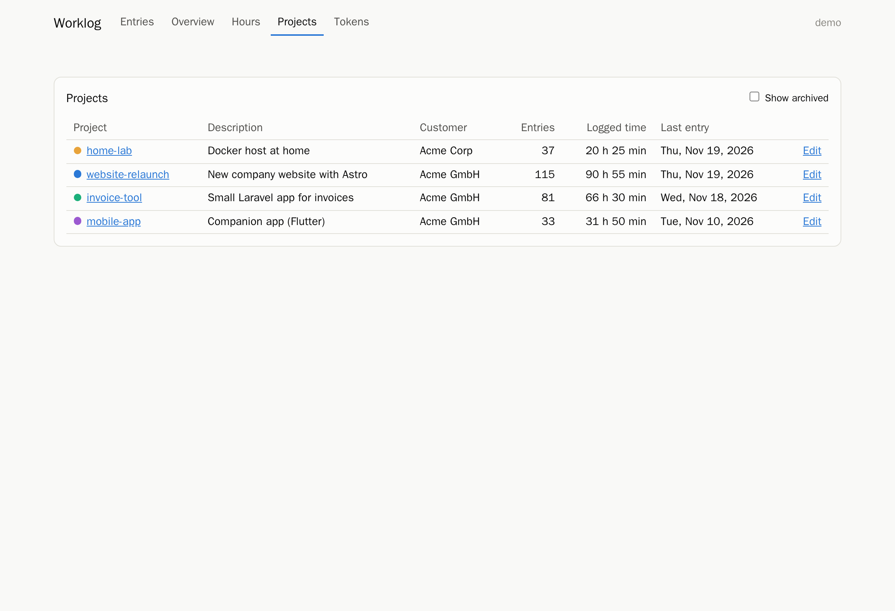
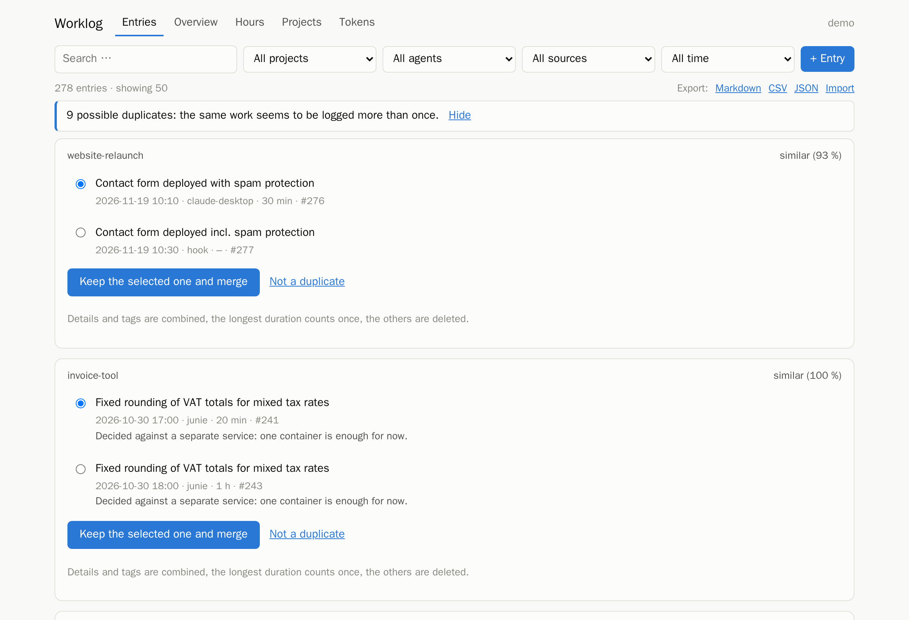

# Web view

`https://<your-host>/ui/` shows the log in the browser. It loads nothing from other hosts and follows the light or dark theme and the language (English or German) of the browser. The screenshots show made-up demo data (`worklog demo-data --owner demo`).

<picture><source media="(prefers-color-scheme: dark)" srcset="images/entries-dark.png"></picture>

- **Entries:** newest first, grouped by day, with full text search and filters for project, agent, source and period. Click an entry for details and tags, click a project to filter by it. Filters are kept in the URL, so a view can be bookmarked.
- **+ Entry** (needs write rights): log work by hand, e.g. from the phone or for work without an agent – with project suggestions, time, duration, details and tags. Such entries have the source `web`.

<picture><source media="(prefers-color-scheme: dark)" srcset="images/overview-dark.png"></picture>

- **Overview:** totals, time or entries per project, an **activity calendar** (one square per day, darker = more; click a day to see its entries) and a chart per day, week or month (chosen by the length of the period), also available as a table.

<picture><source media="(prefers-color-scheme: dark)" srcset="images/timesheet-dark.png"></picture>

- **Hours:** a timesheet – projects as rows, days, weeks or months as columns (*Auto* picks by the length of the period), totals per row and column. Uses the filters above. *Round up to* 15, 30 or 60 minutes rounds every cell up (e.g. for billing); the CSV link downloads exactly what is shown.

<picture><source media="(prefers-color-scheme: dark)" srcset="images/projects-dark.png"></picture>

- **Projects:** all projects with entries, time and last entry. With write rights you can add a description, a customer and a color, or archive a finished project (hidden from the list unless *Show archived*; agents see the flag in `list_projects`). Renaming a project keeps these details.
- **Export:** the current filter as Markdown, CSV or JSON download (links above the list).
- **Import** (needs write rights, see below): a JSON export, e.g. from another worklog instance, becomes part of your log. See [JSON export and import](data.md#json-export-and-import).
<picture><source media="(prefers-color-scheme: dark)" srcset="images/duplicates-dark.png"></picture>

- **Duplicates:** entries that look like the same work logged twice (same project, at most 3 hours apart, nearly the same summary; summaries with different numbers never count) are shown above the list. Pick the one to keep and merge: details and tags are combined, the longest duration counts once, the earliest time stays, the others are deleted. *Not a duplicate* hides the group for good. Both need write rights.
- **Corrections** (need write rights): edit or delete an entry (open it, then *Edit* / *Delete*); with a project filter set, *Rename project …* renames it, or merges it into an existing project.
- **Tokens** (only after signing in through the proxy): create your tokens, see when each was last used, revoke them. A new token is shown once.

## Signing in through a reverse proxy (recommended)

Put `/ui` behind the login you already use for other services, e.g. Traefik forward auth with Authelia, Authentik or oauth2-proxy. The proxy sets the user name in a header (`Remote-User` by default) and a shared secret in `X-Worklog-Proxy`; worklog trusts the user header only when the secret matches, so nobody can fake it by talking to the container directly. Users signed in this way read their own entries and manage their own tokens.

```bash
# .env: a random secret, at least 24 characters
WORKLOG_PROXY_SECRET=$(openssl rand -base64 32)
```

`compose.example.yaml` contains the Traefik routers for this (commented out): a second router for `/` and `/ui` with the auth middleware followed by one that adds the secret, and a middleware on the main router that removes both headers from requests to `/mcp` and `/api`. Token changes are accepted only from the page itself (same origin, JSON body).

## Signing in with a token

Without a proxy login, sign in on the page with a token that has the `read` scope; a dedicated one is a good idea:

```bash
docker exec -it worklog-mcp worklog token create web --owner <user> --scopes read         # look only
docker exec -it worklog-mcp worklog token create web --owner <user> --scopes read,write   # also edit and import
```

The browser gets a signed session cookie (HttpOnly, SameSite=Strict, Secure behind HTTPS, 30 days). It never contains the token and stops working when the token is revoked.

**Rights in the web view:** signed in through the proxy, you may do everything with your own data. Signed in with a token, you get that token's rights: with `read` you can read and export; with `read` and `write` you can also edit, delete, rename, merge duplicates and import. Managing tokens always needs the proxy sign-in, so an agent's token cannot create more tokens. Changes are accepted only from the page itself (same origin, JSON body).

## JSON for scripts

`GET /api/entries` (`q`, `project`, `agent`, `source`, `since`, `until`, `limit`, `offset`), `GET /api/facets` and `GET /api/stats` with a bearer token that has the `read` scope. The page itself uses the same endpoints below `/ui/api/`.
